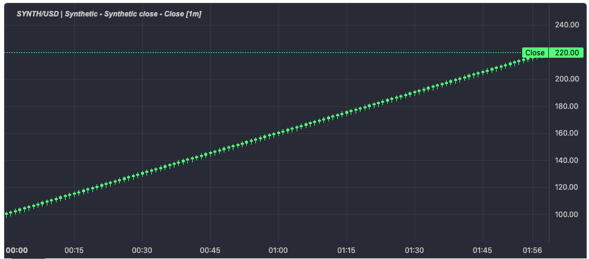

# Lightweight Schema Charts

A schema-driven, declarative chart layer for [Lightweight Charts](https://tradingview.github.io/lightweight-charts/).

Instead of imperatively creating series and pushing points, a consumer declares data streams and lets presenters describe the shape of each stream's data. The schema composes panes, groups, and visible series from those declarations, and the renderer reconciles changes into Lightweight Charts. The chart never needs to know what a consumer's models look like.

## Status

The Ember package renders a working chart and is covered by an acceptance test that mounts it, updates the data, and tears it down. Nothing is published.



*120 synthetic candles rendered as a candlestick series in a single pane. The title is composed from the instrument, provider, stream, and field; the price scale and crosshair are Lightweight Charts.*

Two things are deliberately incomplete. The framework-neutral core is a placeholder, and the renderer currently lives entirely in the Ember package. The repository is moving toward the dependency direction below rather than claiming it today.

## Packages

| Package                            | Purpose                                                                                         |
| ---------------------------------- | ----------------------------------------------------------------------------------------------- |
| `@lightweight-schema-charts/ember` | Ember host: schema factory, provider and presenter contracts, series adapters, and the modifier |
| `@lightweight-schema-charts/core`  | Intended framework-neutral renderer. Currently holds pure snapshot and diff functions           |

## Dependency direction

```text
Ember host ─→ @lightweight-schema-charts/ember ─→ @lightweight-schema-charts/core ─→ lightweight-charts
```

The intended core owns reconciliation, adapters, and lifecycle without knowing Ember, Glimmer, an application store, or a component library. The Ember package owns element lifecycle, scheduling, and the reactive schema composition.

## How a consumer wires a chart

Four pieces, all supplied by the consumer:

1. **Data providers** implement the provider contract. A provider exposes its stream identifiers, a default layout, a cursor, incremental data fetching, plain per-stream data state, and a stable group identity per stream.
2. **Presenters** describe a stream: its display names, structural descriptors, default visible fields, and how a raw sample projects into series points.
3. **A presenter factory** maps a consumer's own provider and stream types to the right presenter. This is the plugin seam: the package never enumerates provider types.
4. **A schema** is created from those inputs and exposes a chart state that the modifier renders.

```ts
const schema = createReactiveChartSchema({
  getDataProviders: () => new Set([myProvider]),
  presenterFactory: {
    makeDataStreamPresenter: ({ dataProvider, dataStreamIdentifier }) =>
      presenterFor({ dataProvider, dataStreamIdentifier }),
  },
});
```

The modifier takes the state, an adapter registry, and a small domain context:

```gts
<div
  style="height: 320px; width: 640px"
  {{ChartLwcAdapterModifier this.state this.registry this.domainContext}}
></div>
```

`test-app/app/synthetic/synthetic-chart.ts` is the reference adapter: a complete synthetic provider, presenter, and candle set. It is the fastest way to see the required shapes.

## Workspace

```text
.
├── packages/
│   ├── charts/              @lightweight-schema-charts/core
│   └── ember-charts/        @lightweight-schema-charts/ember
├── test-app/                Ember integration test application
└── docs/
    ├── architecture/
    └── decisions/
```

The Dev Container forwards port 4200 for the test application.

## Development

The repository owns its toolchain and development container. No host `pnpm install` is required.

```sh
mise run container:up
mise run install
mise run build
mise run lint
mise run typecheck
mise run format:check
mise run test
```

Run `mise run container:shell` to open a shell inside the container, then use package-local `pnpm` commands.

Every workspace package with its own dependencies needs a `node_modules` named volume in `compose.yaml`. The root volume is not enough for pnpm's package-local links.

## Known limitations

- The modifier removes series and panes on teardown but does not dispose the chart instance.
- Package declarations are not emitted by the default build.
- Part of the series projection path still uses an internal currency value type rather than plain numbers.
- One acceptance test covers one rendering path. Adapters, multi-pane layouts, and removal paths are untested.

See [ROADMAP.md](ROADMAP.md) for the engineering work behind these limitations and for the product direction still to be specified.

## Documentation

- [Architecture overview](docs/architecture/overview.md)
- [Decisions](docs/decisions/README.md)
- [Guides](docs/guides/README.md)

## License

Not yet selected. Do not publish or redistribute this repository until licensing is settled.
